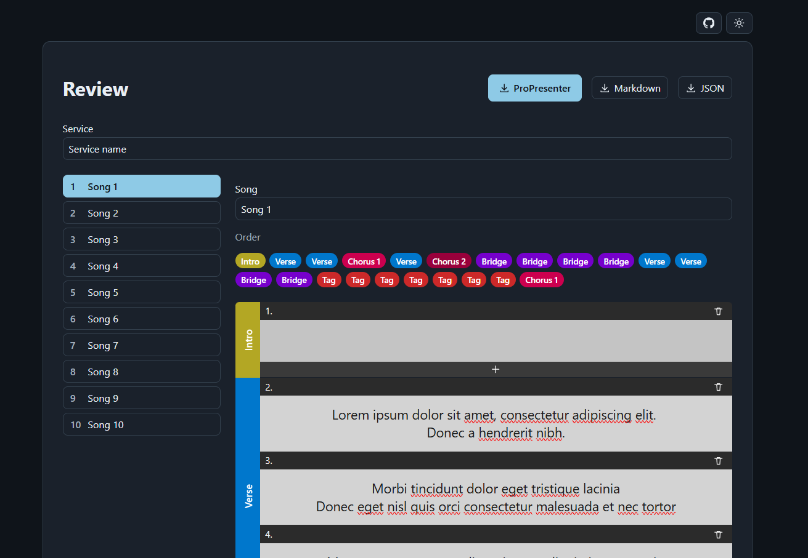

# Singin Teksten Pro

Turns a song lyrics document (PDF or Word) into a ProPresenter 7 bundle, with every song split into labelled groups (Verse, Chorus, Bridge, …) and slides.

It runs fully in the browser: you upload a document, check and edit the songs, and download the result. Nothing is sent to a server.



## Features

- Reads `.pdf` and `.docx` song sheets
- Recognises section labels and translates them to ProPresenter group names with matching colours
- Review screen to rename songs and groups, edit slide text, and leave songs out of the export
- Configurable number of lines per slide, with an optional blank intro slide
- Exports to a ProPresenter `.proBundle`, Markdown, or JSON

## Document format

Each song starts with its title on a line of its own, followed by a `LEAD:` line. After that, every section starts with a label in capitals, followed by its lyrics:

```text
GOD IS GOED
LEAD: Piet

COUPLET 1
First line of the verse
Second line of the verse

REFREIN
First line of the chorus
Second line of the chorus

(REFREIN) (2X)
```

| Label in the document          | Group in ProPresenter |
| ------------------------------ | --------------------- |
| `COUPLET`, `VERS`              | Verse                 |
| `REFREIN`                      | Chorus                |
| `PRE-REFREIN`                  | Pre-Chorus            |
| `BRIDGE`                       | Bridge                |
| `TAG`                          | Tag                   |
| `OUTRO`, `EINDE`               | Ending                |
| `TUSSENSPEL`                   | Interlude             |
| `INTRO`, `SLOT`, `LAATSTE KEER`| Other                 |

- Labels must be written in capitals and may have a number, such as `COUPLET 2`.
- A label in parentheses, such as `(REFREIN)`, repeats an earlier section. Add `(2X)` to repeat it more than once.
- Labels joined with `,` or `&` play several sections in a row, such as `(COUPLET 1 & REFREIN)`.
- `HERHALING` is named after the section before it, with the next number (after `Chorus 1` it becomes `Chorus 2`).
- If the same label appears twice with different lyrics, the second one gets the next number (`Verse 2` becomes `Verse 3`).

## Running it locally

You need the [.NET 10 SDK](https://dotnet.microsoft.com/download). The ProPresenter file format definitions come from a Git submodule, so clone with `--recursive`:

```sh
git clone --recursive https://github.com/maartenverheul/singin-teksten-pro.git
cd singin-teksten-pro
```

If you already cloned without it, run `git submodule update --init`.

### Web app

```sh
dotnet run --project SinginTekstenPro.Web
```

Then open <http://localhost:5252>.

### Command line

Converts a document straight to a `.proBundle` next to the input file, without the review step:

```sh
dotnet run --project SinginTekstenPro.Cli -- path/to/songs.pdf
```

### Publishing

The web app is hosted as a [Cloudflare Worker](https://developers.cloudflare.com/workers/static-assets/) with static assets only. Deploying runs Cloudflare's Wrangler tool through `npx`, so you need [Node.js](https://nodejs.org/) installed and a Cloudflare account. No `npm install` is needed.

```sh
npx wrangler login   # once
dotnet publish SinginTekstenPro.Web -c Release -p:Cloudflare=deploy
```

This publishes the app to `dist/web/wwwroot` and uploads that folder. Use `-p:Cloudflare=preview` instead to try the published build locally first. The Worker settings are in [`wrangler.jsonc`](wrangler.jsonc); the build steps are at the bottom of [`SinginTekstenPro.Web.csproj`](SinginTekstenPro.Web/SinginTekstenPro.Web.csproj).

The published folder is a plain static site, so it can also be hosted anywhere else that serves static files.

## Project structure

| Folder                 | Contents                                                                   |
| ---------------------- | -------------------------------------------------------------------------- |
| `SinginTekstenPro`     | Core library: document readers, song parser and exporters                  |
| `SinginTekstenPro.Web` | Blazor WebAssembly app with the upload and review screens                  |
| `SinginTekstenPro.Cli` | Command-line converter                                                     |
| `ProPresenter7-Proto`  | Submodule with the ProPresenter 7 protobuf definitions                     |
| `Template.pro`         | ProPresenter presentation used as the template for every exported song     |

Most parsing rules live in [`SinginTekstenPro/Input/SongParser.cs`](SinginTekstenPro/Input/SongParser.cs); group colours are in [`SinginTekstenPro/Models/GroupColors.cs`](SinginTekstenPro/Models/GroupColors.cs).
